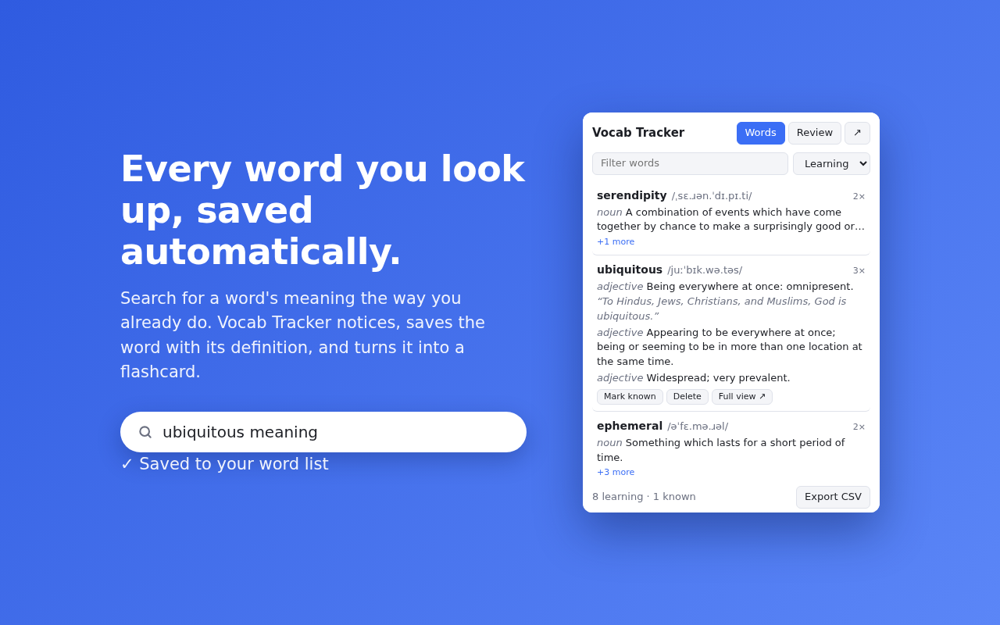
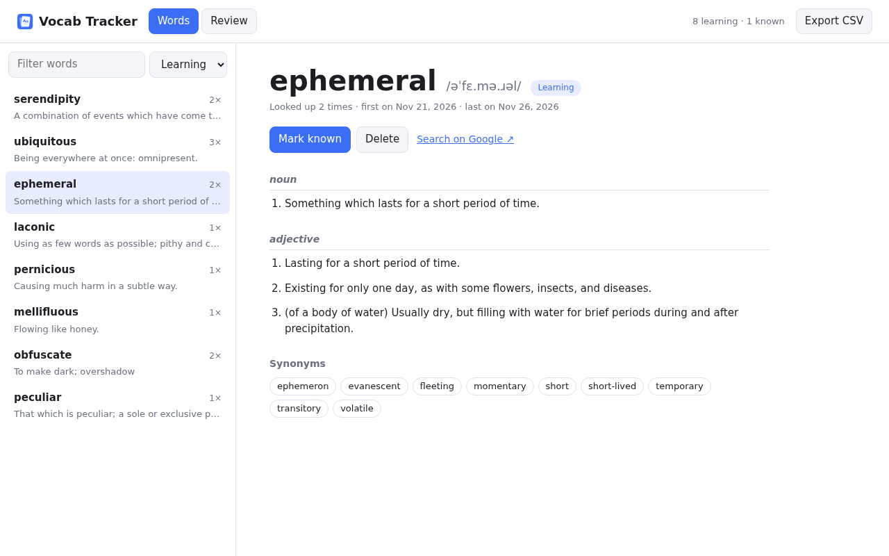
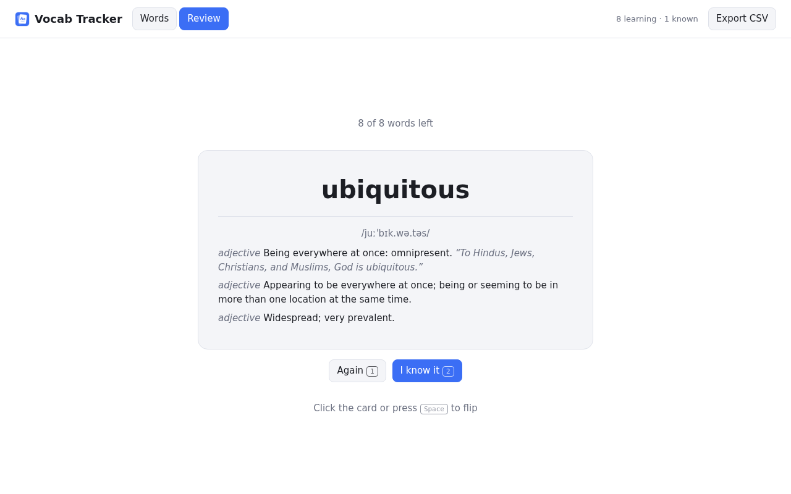

# Vocab Tracker (Chrome extension)

Collects the words you look up on Google and turns them into flashcards automatically.
Search `ubiquitous meaning` from the address bar or google.com, and the word is saved with its definition.



| Full-page view | Flashcard review |
|---|---|
|  |  |

## What it detects

`<word> meaning`, `<word> meaning in <language>`, `<word> definition`, `<word> word meaning`,
`meaning of <word>`, `what is the meaning of <word>`, `define <word>`, `define: <word>`, `what does <word> mean`.
Terms can be 1–3 words (e.g. `carpe diem meaning`). Generic queries like `meaning of life` are ignored.

Looking up a word again bumps its count and moves it back to *Learning*.

## Install

1. Open `chrome://extensions` and turn on **Developer mode**.
2. Click **Load unpacked** and select this folder.

## Use

- Toolbar badge = number of words still being learned.
- **Popup**: compact list with each word's first definition. Click a word to expand it, and click **↗** to open the full view.
- **Full view** (opens in a tab): word list plus a detail pane showing every definition grouped by part of speech, with examples, synonyms and lookup history. Use ↑/↓ to move between words.
- **Review**: flashcards, most-looked-up words first. In the full view, <kbd>Space</kbd> flips, <kbd>1</kbd> = again, <kbd>2</kbd> = I know it.
- **Export CSV**: downloads a `front,back` file with every word and its definitions.

Definitions come from the free [Dictionary API](https://dictionaryapi.dev). Everything is stored locally in `chrome.storage.local`.

## Tests

```
npm test
```

## Privacy

Your word list stays in your browser. Only the looked-up word is sent to dictionaryapi.dev to fetch its definition. See [PRIVACY.md](PRIVACY.md).

## Publishing

`npm run package` builds `dist/vocab-tracker-<version>.zip` for the Chrome Web Store. Bump `version` in `manifest.json` before each upload.
Listing text, permission justifications and store images are in [`store/`](store/listing.md).
